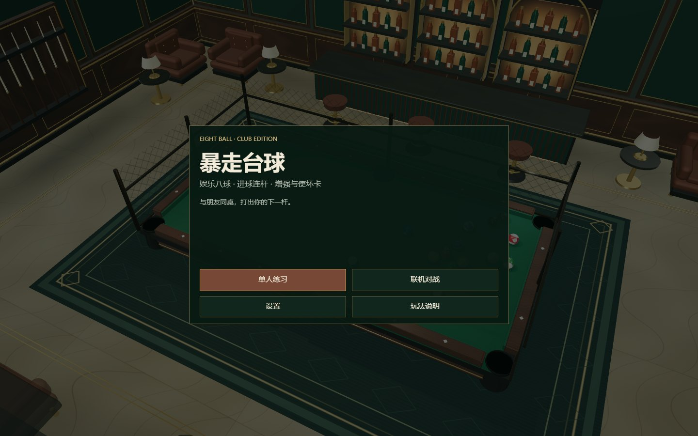
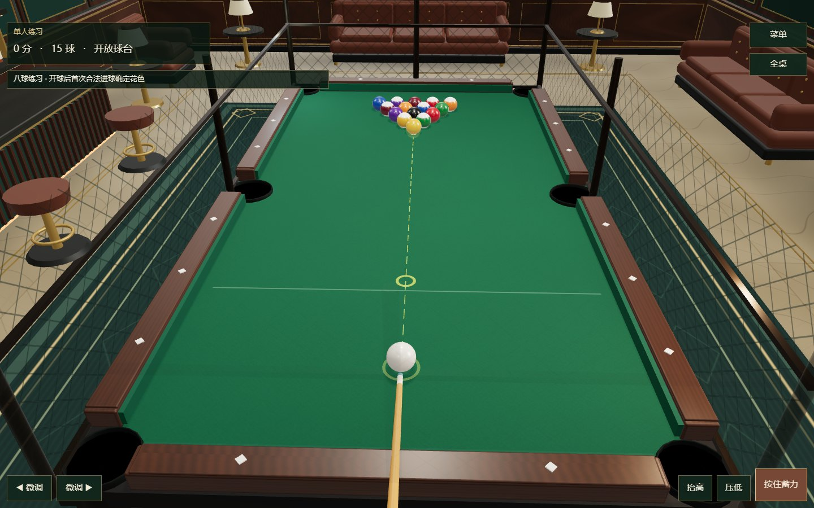

# 暴走台球 · 小游戏版

《暴走台球》的小游戏适配版本，与[网页版](https://github.com/susyimes/iron-cage-open)共享 Three.js 场景、物理、八球规则和网络协议，使用 Canvas 绘制菜单与触屏界面。

## 游戏画面

2026-10-12 在本机 `/minigame-preview.html` 拍摄的小游戏 Canvas 界面和单人玩法；这是浏览器预览，不是微信真机截图。





## 已实现玩法

- 娱乐化八球：分全色与花色，合法进本组球可连杆，清完本组后打黑 8。
- 单人练习与源码中的双人房间模式，共用裁判规则；联机犯规给对手自由球。
- 蓄力、瞄准、可调抬杆角度、自由球摆位、击球视角和全桌观察。
- 增强与使坏卡；单人每合法进 3 球抽卡，联机每累计 6 杆抽卡。
- 可手动选择画质，支持触屏、声音设置与再开一局。

| 操作 | 输入 |
| --- | --- |
| 瞄准 / 抬杆 | 鼠标移动；Q、E / A、D 微调方向；W、S 调抬杆 |
| 蓄力击球 | 按住鼠标左键或空格，松开出杆 |
| 观察 | 右键拖动；滚轮缩放；R 重置；V 全桌 |
| 卡牌 / 菜单 | 1、2、3 / Esc |
| 触屏 | 单指瞄准、双指转镜头、捏合缩放及界面按钮 |

规则与同步见 [docs/NETWORK_SYNC.md](docs/NETWORK_SYNC.md)。这是娱乐化规则，不是对完整赛事规则的认证实现。

## 本地预览

本次使用 Node.js 24.15.0 和 npm。

```sh
npm ci --ignore-scripts
npm run dev -w client -- --host 127.0.0.1
```

小游戏界面：<http://127.0.0.1:43153/minigame-preview.html>。根路径仍可查看网页版。若同时启动两个版本，可加 `--port 43163`，再访问相应端口。

单人练习不需要联机服务。小游戏适配中的旧生产地址已改为 `your-server.example.invalid`；需要联机时，请先在 `client/src/minigame/runtime.ts` 配置自己的 HTTPS / WSS 服务，再构建。默认示例不会访问原生产服务。

## 构建

```sh
npm run build           # 网页构建，输出 client/dist/
npm run build:minigame  # 小游戏 bundle，输出 minigame/js/game-bundle.js
```

微信开发者工具工程位于 `minigame/`，导入、运行配置与操作说明见 [minigame/README.md](minigame/README.md)。公开配置不含原 AppID 或本机项目配置。填写自己的 AppID 和服务域名后，再做平台预览、真机验收与发布。

2026-10-12 已验证锁定安装、浏览器小游戏菜单与单人入口、网页构建及小游戏构建。本次没有登录微信开发者工具、上传代码或验证微信真机、后台审核、外网联机。项目已有 `npm run test:minigame`、`npm run test:online`、`npm run typecheck`，本次未全量重跑。

## 技术栈与限制

TypeScript、Three.js、Vite、Canvas UI；微信运行适配位于 `client/src/minigame/`，入口为 `client/src/minigame-entry.ts`。浏览器验证入口复用小游戏界面，不替代真实微信环境的 WebGL、音频、触控、后台切换或 socket 验收。

功能对照见 [docs/MINIGAME_PARITY.md](docs/MINIGAME_PARITY.md)。本作未提供账号、排位或防作弊服务，实际画质和帧率依设备而定。

## 素材与许可状态

球台、房间、球号、材质与部分效果由 Three.js 和程序化纹理构建，效果声使用 Web Audio。页面引用 Google Fonts 中的 IBM Plex Mono、Noto Sans SC、Oswald，保留字体各自条款。

维护者确认 `client/public/emblem.jpg` 与 `client/public/icons/*.png` 为可商业使用和分发的生成图像。其素材范围单独记于 [ASSETS.md](ASSETS.md)。原 `jazz.mp3` 及历史 `club.mp3` 的音乐许可未确认，公开文件和 Git 历史均不包含这些录音；游戏直接使用已有 Web Audio 合成环境底声和效果声，不请求缺失音乐。截图画面保持有效。

小游戏不再打包旧音乐。私人开发工具配置未复制；公开配置需填写自己的 AppID，联机服务默认使用不可路由的示例域名，必须先配置自己的服务。

## 许可证

本项目自有代码采用 [MIT 许可证](LICENSE)。素材范围与来源见 [ASSETS.md](ASSETS.md)；第三方依赖及素材保留原有条款，不因代码 MIT 而被重新授权。

本仓库从已清理的当前文件建立独立 Git 历史；原私库与原工作区保留。

2026-10-13 清理公开版验证：网页与小游戏构建通过，触控、运行适配和界面三个自测全部通过；浏览器小游戏可正常进入单人模式，没有旧音乐请求、缺失资源或页面异常。minigame/THIRD_PARTY_LICENSES.txt 保留打包 Three.js 的 MIT 声明。未执行微信真机验收。
